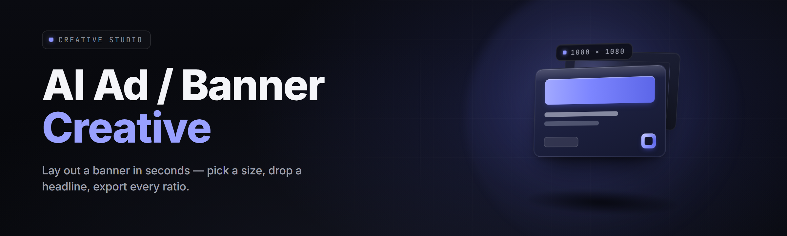

  
  
  

  

  
  

---

**Describe the ad. The generator builds the creative.** Batch-render banner sets, populate A/B copy, export every size a campaign needs — from one prompt box and a CSV of offers.

---

## 📋 Table of Contents

- [Overview](#-overview)
- [Compatibility & Platform Support](#-compatibility--platform-support)
- [What is AI Ad / Banner Creative Generator](#-what-is-ai-ad--banner-creative-generator)
- [Key Features](#-key-features)
- [The Problem](#-the-problem)
- [The Solution](#-the-solution)
- [Quick Start](#-quick-start)
- [Module Catalog](#-module-catalog)
  - [🧠 Generation Core](#-generation-core)
  - [🎨 Layout & Composition](#-layout--composition)
  - [✍️ Copy & Localization](#️-copy--localization)
  - [📐 Export & Delivery](#-export--delivery)
  - [🔍 Diagnostics & QA](#-diagnostics--qa)
  - [⚙️ Automation & Pipelines](#️-automation--pipelines)
- [Comparison](#-comparison)
- [System Requirements](#-system-requirements)
- [Installation](#-installation)
- [Known Issues](#-known-issues)
- [Tips for Best Results](#-tips-for-best-results)
- [Usage Guidelines](#-usage-guidelines)
- [Hotkeys](#-hotkeys)
- [FAQ](#-faq)

---

## 🗂️ Overview

| Category | Details |
|---|---|
| **Product** | AI Ad / Banner Creative Generator |
| **Type** | Windows desktop suite — `.exe`, portable, no installer required |
| **Release** | v2.4.1 (2026 stable channel) |
| **Engine** | Local diffusion + layout solver + copy LLM, GPU-accelerated |
| **Input** | Prompt / CSV brief / brand kit / offer feed |
| **Output** | PNG / WebP / SVG-hybrid banner sets, copy variants, manifest JSON |
| **Last Updated** | 2026-02-11 |

A campaign brief goes in as a sentence, a CSV of offers, or a folder of product shots. The generator renders banner-family sized variants, writes copy variants per placement, keeps your brand kit locked, and hands back a manifest your ad server or CMS can ingest directly. Built for media buyers, indie growth teams, and creative-ops devs who ship banners in bulk, not one at a time.

---

## 🧩 Compatibility & Platform Support

| Platform / Host | Support Level | Notes |
|---|---|---|
| Windows 11 (22H2+) | ✅ Full | Best perf on DX12 + WDDM 3.x |
| Windows 10 (21H2+) | ✅ Full | CUDA/Metal-agnostic path available |
| DirectML (AMD/Intel iGPU) | ✅ Full | Fallback when no CUDA device |
| PowerShell 5.1 automation | ✅ Full | CLI + batch job runner |
| CI/CD (self-hosted runner) | ⚠️ Beta | Headless render mode, no GUI |
| macOS | ❌ Not shipped | .exe desktop release is Windows-first |
| Linux | ❌ Not shipped | Track community fork discussions |

---

## 🏷️ What is AI Ad / Banner Creative Generator

| Term | Explanation |
|---|---|
| **Creative** | The rendered ad unit — banner, static, or animated thumbnail |
| **Brief** | Structured input: offer, audience, tone, CTA — prompt or CSV row |
| **Brand Kit** | Locked palette, logo assets, type scale, safe-area rules |
| **Variant** | One rendered composition against a brief (A, B, C… under test) |
| **Placement Bundle** | A set of banner sizes that matches one ad-network spec (e.g. Google, Meta, X) |
| **Manifest** | JSON describing every produced file, its brief, size, and slot |

- No cloud dependency — runs entirely on your machine, outputs stay local.
- Deterministic seeds — re-render any variant byte-identical from its manifest.
- Batch-first — one CSV row becomes dozens of sized outputs.
- Copy-aware — headline and CTA are generated to fit the safe area, not clipped.

---

## 🔧 Key Features

**Feature** modules organize the release. Full breakdown lives in the [Module Catalog](#-module-catalog).

---

## 🕳️ The Problem

- A single campaign needs 30+ sizes; making them by hand burns a week.
- Copy variants are written per-size instead of per-audience, so messaging drifts.
- Brand kit rules (safe areas, palettes, logo padding) get broken the moment someone hand-places a CTA.
- Rotating offers means the previous banner set is stale before it launches.
- Exporting from design tools produces inconsistent naming — breakage downstream.
- Non-English markets need localized copy but the pipeline doesn't loop it in.
- QA is eyeballed, so broken type or off-brand colors ship to paid traffic.

---

## 🩹 The Solution

| Problem | Solution |
|---|---|
| 30+ sizes hand-built | Placement Bundle presets render a full sized family from one composition |
| Copy drifts per size | Copy pipeline generates one message, reflows it into every safe area |
| Brand kit breaks | Brand Kit Locks enforce safe areas, palette, logo padding before export |
| Stale offer sets | Offer feed ingestion — update CSV, re-run batch, get fresh creatives |
| Naming chaos | Manifest naming template keeps files consistent per ad server |
| No localization loop | Copy & Localization module renders per-locale variants in one pass |
| Eyeball QA | Diagnostics pass flags overflow, contrast, missing CTA, off-brand color |

---

## ⚡ Quick Start

1. 🧲 Visit the project page → download the `.exe` → extract the archive to a folder.
2. 🖱️ Run the `.exe`. The Creative Studio window opens with an empty project.
3. 🎯 Load your **Brand Kit** (palette, logo, fonts) or pick a starter kit.
4. 📝 Paste a brief, drop a CSV of offers, or type a single prompt.
5. 🚀 Hit **Batch Render**. Choose a Placement Bundle, hit go, get your banner set + manifest.

---

  

---

## 🧠 Module Catalog

27 feature modules organized into six domains. Every module is invokable from the GUI, the CLI, or the batch job runner.

### 🧠 Generation Core

1. **Prompt Composer** — turns a short brief into a structured generation prompt with style, mood, and audience tags.
2. **Diffusion Renderer** — the core image generator; honors brand palette and safe areas as hard constraints.
3. **Seed Vault** — stores every render's seed alongside its brief so any variant is reproducible on demand.
4. **Style Transfer Pass** — takes a reference banner and rebuilds a new brief in the same visual language.
5. **Subject Isolation** — extracts product shots from a background and composites cleanly into the canvas.

### 🎨 Layout & Composition

6. **Safe Area Solver** — enforces placement-safe margins before copy is placed.
7. **Auto-Composer** — arranges logo, headline, CTA, and hero into a balanced grid.
8. **Grid Snapper** — snaps every element to configurable 4/8px rhythm grids.
9. **Contrast Guard** — checks every copy color against its backdrop and rewrites if below threshold.
10. **Responsive Scaler** — regenerates composition faithfully across 300×250 → 970×250 and verticals.
11. **Ratio Shift** — reformats a banner to a new aspect ratio without stretching the hero.

### ✍️ Copy & Localization

12. **Headline Writer** — generates headlines fit to the safe area's width cap.
13. **CTA Bank** — manages reusable calls-to-action per offer and locale.
14. **Offer Injector** — merges CSV offer rows into copy slots, keeping type within metrics.
15. **Locale Passes** — renders per-locale variants with RTL support and font pairings.
16. **Tone Dial** — shifts register (bold/quiet/technical/playful) without rewriting slots.

### 📐 Export & Delivery

17. **Placement Bundle Presets** — Google Display, Meta, X, LinkedIn, programmatic specs, custom.
18. **Manifest Writer** — JSON per batch: brief, seed, sizes, filenames, hashes.
19. **Naming Template** — configurable filename scheme per asset server.
20. **Format Exporter** — PNG, WebP, JPEG, and SVG-hybrid vector layers.
21. **Watch Folder** — auto-exports each batch to a directory your ad server monitors.

### 🔍 Diagnostics & QA

22. **Overflow Check** — flags any copy block that exceeded its allocated box.
23. **Brand Compliance Scan** — asserts palette, logo padding, and type scale were respected.
24. **Blank Canvas Detector** — catches generations that failed to place a hero.
25. **Diff Viewer** — shows side-by-side comparison against the previous batch.

### ⚙️ Automation & Pipelines

26. **Batch Job Runner** — queues briefs from CSV, JSON, or a watched directory.
27. **CLI + Script Harness** — drive every module from PowerShell or your own scripts.

---

## ⚖️ Comparison

| Aspect | Manual Design Tools | Generic AI Gen | **This Tool** |
|---|---|---|---|
| Sized family from one composition | Hand-resize every size | One aspect only | ✅ Auto per Placement Bundle |
| Copy fits safe areas | Eyeball | Clipped | ✅ Solver-driven |
| Brand kit enforcement | Optional | Ignored | ✅ Hard lock |
| Localization loop | Separate pass | Manual | ✅ Built-in locale variants |
| Reproducibility | Manual | Non-deterministic | ✅ Seed Vault |
| Batch from CSV offers | No | No | ✅ Offer Injector |
| Output naming | Manual | Manual | ✅ Naming Template |
| QA pass | Eyeball | None | ✅ Diagnostics modules |

---

## 💽 System Requirements

| Component | Minimum | Recommended |
|---|---|---|
| OS | Windows 10 21H2 | Windows 11 22H2+ |
| CPU | 6-core | 12-core |
| RAM | 16 GB | 32 GB |
| GPU | 6 GB VRAM (DirectML) | 10 GB VRAM (CUDA) |
| Disk | 8 GB free | 25 GB free SSD |
| Runtime | VC++ 2022 redist | VC++ 2022 + DirectX 12 |

---

## 🧲 Installation

1. **Download.** Grab the release archive from the project page and place it in a folder you control (not `C:\Program Files` if you want user-writable brand kits).
2. **Extract.** Unzip with any explorer — the archive unpacks into the app folder with the `.exe` at the root. Run once so it seeds its config under `%APPDATA%`.
3. **Run.** Double-click the `.exe`. First launch walks you through Brand Kit import, GPU device selection, and Placement Bundle presets. Batch render from there.

---

## 🧯 Known Issues

| Issue | Solution |
|---|---|
| First render is slow on first run | Shader cache warms over 1–2 minutes; subsequent renders are fast. |
| DirectML device not detected | Update GPU driver; select device manually in Settings → Device. |
| Brand font missing on export | Embed fonts in the Brand Kit, don't rely on system-installed fonts. |
| Manifest paths break on network share | Use UNC paths (`\\server\...`), not mapped drive letters. |
| Arabic locale overlaps CTA | Enable RTL shaping in Locale Passes; check font supports shaping. |
| Antivirus quarantines `.exe` | Some signatures flag unsigned builds; allow-list the folder. Deterministic, no external calls — real signature feedback welcome. |
| Watch Folder doesn't fire | Grant the folder read access and confirm path has no trailing spaces. |

---

## 🥇 Tips for Best Results

- Give the Brand Kit first — palette, logo (PNG with transparency), and font pair.
- Use the Offer Injector with a CSV that has a `locale` column for best localization coverage.
- Keep hero assets square-ish; the Ratio Shift module handles the rest.
- Run Diagnostics every batch for the first week of a new brand kit.
- Freeze a Style Transfer result you like and re-use it as the reference for the rest of the campaign.
- Prefer PNG for programmatic; WebP for social statics; SVG-hybrid where the ad server accepts it.
- Do not exceed 4 active headline variants per audience for clean A/B readouts.

---

## 🧾 Usage Guidelines

| Allowed | Not Allowed |
|---|---|
| Generating creatives for your own campaigns | Infringing third-party trademarks in generated assets |
| Reselling banners you generated | Redistributing the `.exe` while claiming original authorship |
| Modifying the app for internal pipelines | Using the tool to forge content for fraudulent offers |
| Teaching the tool in tutorials, streams, courses | Bypassing brand-kit locking in a client-shared workspace |

---

## ⌨️ Hotkeys

| Action | Shortcut |
|---|---|
| New project | `Ctrl+N` |
| Batch render current brief | `Ctrl+Enter` |
| Run Diagnostics | `Ctrl+D` |
| Toggle Safe Areas overlay | `Ctrl+Shift+S` |
| Open Manifest for last batch | `Ctrl+M` |
| Switch to Copy pane | `Alt+2` |

---

## 🧩 FAQ

Do I need an internet connection to run the generator?

No. Once the release is extracted, everything — diffusion, layout, copy, export — runs locally. Optional online features are not part of the shipped default.

How long does a full Placement Bundle render take?

On a 10 GB VRAM GPU, a 30-size bundle from a single composition takes roughly 40–90 seconds depending on copy locale count and export formats. Batch further and it scales linearly.

Can I bring my own copywriting model?

The Copy & Localization modules accept an external endpoint for headline/CTA generation. Provide it in Settings → Copy → Endpoint; the rest of the pipeline stays local.

Does the tool detect ad-network policy violations?

Not in the sense of "policy." Diagnostics checks brand compliance, overflow, contrast, and missing CTA. Ad-network text-percentage rules are enforced through safe-area constraints, not a separate scan.

What formats does the exporter produce?

PNG, WebP, JPEG, and an SVG-hybrid layer that preserves text and vector marks for downstream editing. Programmatic formats (e.g. HTML5 double-click tags) are available via the CLI harness.

Will it scale my banners to any size I want?

Yes. Responsive Scaler regenerates the composition for arbitrary dimensions. For sizes collapsing the safe area, the layout solver reflows copy instead of clipping.

How does the tool keep variants reproducible?

Every render writes its input brief, seed, brand-kit hash, and placement bundle to the Manifest. Re-running the same manifest entry reproduces the same output bit-for-bit.

Can I run this headless on a build agent?

Headless mode ships as a beta flag. Drive it via the CLI harness from a self-hosted runner; the GUI is optional in that mode.

Do I need admin rights?

No admin rights are required. Extract to a user-writable folder and run. First launch writes config under `%APPDATA%`, brand kits where you choose.

Are updates automatic?

No silent updates. Point Settings → Updates at the project page to check for new releases. Nothing in the app phones home.

---

  

The 2026 line concentrates the entire pipeline — brief to rendered banner set to manifest — into a single desktop run. If your team's bottleneck is creative throughput, this is the module set that eats the wait. Ship a campaign in an afternoon, keep the seed vault read-only, and let the manifest be the source of truth.

*For educational and open-source community use. You are responsible for the assets and copy you generate and for respecting the ad-network policies you publish under.*
